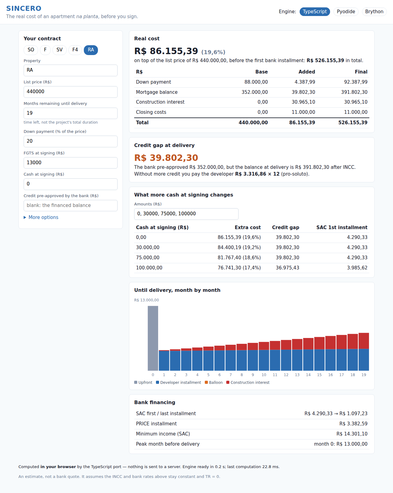
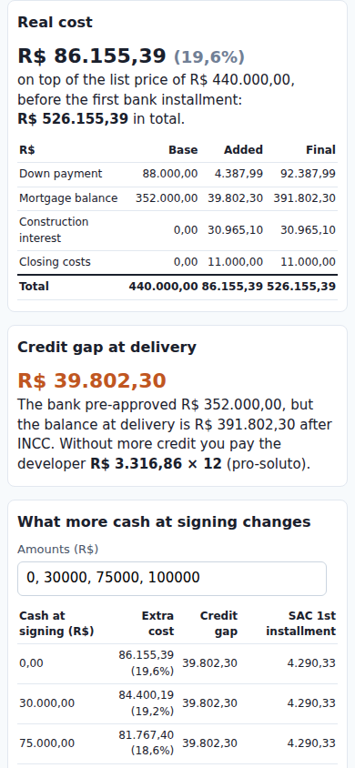

# Experiment: the engine in the browser, no server

*Status: run end to end, 2026-11-08, headless Chromium 141 on a Linux sandbox (4 cores). Saved
output: [`output.txt`](output.txt). Nothing here changes the application: the Python engine is read
from `backend/app/` at build time and the behave suite from `backend/features/`, both unmodified.*

## The question

SINCERO should be usable by people who cannot run Python. A web page is the shortest path to them
(no install, works on a phone), and the engine is pure Python with no I/O (`app/models` and
`app/views` import only the standard library), so it could run **inside the browser**: a static
site, no API server, nothing to host but files, and no input ever leaves the user's device.

Which way of getting the engine into the browser? Run the unchanged Python (four runtimes tried),
or port it to TypeScript? And can a port be *proven* faithful, not just assumed?

## Result

| | **TypeScript port** | **Pyodide** | **Brython** | MicroPython | Transcrypt |
|---|---|---|---|---|---|
| What it is | the engine rewritten, 650 lines | CPython 3.14 compiled to WebAssembly | Python translated to JavaScript at runtime | PyScript's small runtime | Python → JavaScript ahead of time |
| Runs `backend/app` unchanged | — (a port) | ✅ | ✅ | ❌ [no dataclasses, drops annotations](#micropython-and-transcrypt-cannot-run-the-engine) | ❌ [a 3.9 subset](#micropython-and-transcrypt-cannot-run-the-engine) |
| 54 behave scenarios, run **in the page** | ✅ 54/54 | ✅ 54/54 | ✅ 54/54 | | |
| Differential: 429 cases, 1,791,838 numbers vs CPython | **100 % bit-identical**, every message identical | **100 % bit-identical**, every message identical | 99.874 %; **2 error messages differ** | | |
| Download, first visit (gzip) | **0.01 MB** | 6.4 MB | 1.3 MB | | |
| First result, desktop, first / repeat visit | **0.2–0.6 s / 0.1–0.2 s** | 4.4–4.5 s / 3.3–4.3 s | 4.8–10.5 s / 5.6–8.7 s | | |
| First result, phone profile¹, first / repeat visit | **0.7–1.0 s / 0.3–0.5 s** | 47–53 s / 16–21 s | 29 s / 20 s | | |
| Each update² desktop / phone profile¹ | **7–11 ms / 10–21 ms** | 41 ms / 198–229 ms | 0.6–1.0 s / 4.4 s | | |

¹ Lighthouse's mobile throttling: 150 ms RTT, 1.6 Mbit/s, CPU slowed 4× — a harsh, standard
reference, not a real phone. ² What the UI runs on every keystroke: simulate + a 4-rung cash
ladder, including the JSON hand-off. Ranges: two measurement sessions, each a median of 3 runs
(`harness/measure.py`); the sandbox is shared, so read them as orders of magnitude.

**Conclusion.** The TypeScript port is the only option that is fast on a phone, and the harness proves
it gives the Python engine's figures **to the bit**. Pyodide is equally exact and needs no port, but
it takes close to a minute to the first result on the phone profile (16–21 s even from cache).
That is fine for a desktop tool and too slow for a buyer on a phone. Brython is exact to the cent
but not to the message, and too slow to recalculate as you type.





## Findings

### 1. The TypeScript port is exact, and the reason is two CPython details

The port mirrors `app/models` + `app/views/json_view.py` module by module, keeping the order of the
floating-point operations. Two CPython behaviours have no JavaScript counterpart and had to be
reproduced (`engine-ts/pyfloat.ts`):

- **`sum()` is not `a + b + …`.** Since Python 3.12, `sum()` of floats uses Neumaier compensated
  summation: ten 0.1s give `1.0`, not `0.9999999999999999`. The engine sums every schedule, so a
  naive loop changes 2,254 of the 1.79 M numbers (the last digits of totals).
- **`f"{x:,.2f}"` rounds exact ties to even.** `0.125` → `"0.12"` in Python, `"0.13"` with
  JavaScript's `toFixed`. The model formats amounts into its error messages
  (`upfront payments of R$ 500,000.12 exceed…`), and the behave suite compares them verbatim.

With both, 100 % of the numbers are bit-identical in Chromium 141. That also depends on `**`, which
is the JavaScript engine's, not the code's (`probes/pow.mjs`, 200,000 seeded powers vs CPython):

| JavaScript engine | `(1+r)**(1/12)` differs | `(1+m)**k` differs | golden digests (425 cases) |
|---|---|---|---|
| Node 22 (V8 12.4) | 1,029 | **19,206** | 366 identical |
| Node 24 (V8 13.6), Node 25 (V8 14.1), Chromium 141 | 0 | 0 | **425 identical** |

The differences are in the last bit (the figures agree to the cent), but a bit-exact gate has to run
on V8 ≥ 13.6: **pin Node ≥ 24**. `harness/golden_digest.{py,mjs}` is the prototype of that gate: one
SHA-256 per case over the exact bits of the reply, 34 KB for the whole corpus, computed the same way
in Python and in Node, so the Python engine can be retired without losing it as the reference.

### 2. behave alone cannot validate a port; the differential test can

Negative controls, each planted in the TypeScript port and reverted (`output.txt`):

| Planted bug | behave, in the page | differential |
|---|---|---|
| construction interest on `(k − 1)/N` of the balance instead of `k/N` | **8 of 54 fail** | fails: 29,335 figures off by more than half a cent |
| `sum()` as a naive loop | **54/54 pass** | fails: 2,254 numbers differ (≤ 6.3e-8) |
| `bank_rate_pa` default 10.25 instead of 10.26 | (not run) | fails: the field-table check names it |

The suite's 399 steps check figures with a half-cent tolerance; that is right for a business
specification and blind to last-digit drift. The differential test compares every number of every
payload, including the three schedules, and every rejection message. A port needs both. The
naive-sum mutant reproduces Brython's profile (2,254 differing numbers in both, the same worst case),
which points to where Brython's deviation comes from.

### 3. Pyodide: exact, unchanged, heavy to start

The real CPython runs the real code, so there is nothing to keep in sync: 100 % identical with no
effort. The cost is the runtime: 13.6 MB (6.4 MB gzipped) and, above all, CPU at start-up
(instantiating the WebAssembly, importing the standard library). On desktop the repeat visit is
barely faster than the first (3.3–4.3 s vs 4.4–4.5 s), so the download is not the bottleneck. Not tried:
a Web Worker (the page stays responsive while it loads, but still waits), memory snapshots and a
trimmed standard library. They could cut the wait, but not to the ~1 s of the port.

### 4. Brython: unchanged code, but not the same engine

It ran the engine unchanged and passed 54/54, but its `sum()` is naive and its `{:,.2f}` rounds
differently: **two rejection messages show a different amount** from the CLI's (`R$ 416,184.98`
vs `R$ 416,184.97`). It is also the slowest to recalculate: 0.6–1.0 s per update on desktop and
4.4 s on the phone profile. Its numbers were the noisiest across runs.

### MicroPython and Transcrypt cannot run the engine

- **MicroPython** (`probes/micropython.mjs`, 540 KB runtime) has no `__future__`, `typing` or
  `dataclasses`, and stubs would not help: it **discards class annotations** (`x: int` leaves no
  trace), which is how a dataclass finds its fields. It also ignores `,` in `{:,.2f}` and adds
  floats naively.
- **Transcrypt** (`probes/transcrypt.sh`, 3.9.5) compiles "a small sane subset" of Python 3.9. It
  refuses the engine's relative imports. Once those are rewritten, it stops at
  `app/models/validators.py` line 30 (`...`, the body of an abstract method) with a message that
  does not say what it rejects. Each fix would be a change to the engine for the sake of the
  compiler, which makes it a port without a port's benefits.

### 5. The port's size and upkeep

The port is 650 lines of code (the Python it mirrors is about 800, docstrings included) and 12.9 KB
minified. The cost is real: **two implementations of the engine**. Every change to a rule must land
in both, and the harness is what keeps them equal:

- `harness/run_features.py --engine ts`: the business scenarios, through the port, in the browser;
- `harness/differential.py`: every number and message vs CPython, on recorded + random inputs;
- the field-table check: the port's fields, groups and defaults vs the Python DTOs (which are
  generated from `simulation_input.proto`).

The port's field table is hand-written here. A production port would generate it from
`simulation_input.proto` with `protoc-gen-es`, as `make dto` does for Python; the frontend already
has that code generation.

## What it would change in the plan

If the engine runs in the browser, most of M5 stops being on the path to users:

| Today's plan | With the engine in the page |
|---|---|
| Connect server, store, 7 RPCs, error mapping, `ConnectGateway` (5.5–5.14) | Not needed for the UI. The `.proto` can still type the port's inputs and results |
| CORS, rate limiting, request-size limits, a host with one worker (5.17, US-12, US-13) | A static host (GitHub Pages, Netlify, Cloudflare Pages): free, nothing to abuse, nothing to scale |
| LGPD care for inputs sent to a server | Inputs never leave the browser |
| Shareable links via server-side ids | Encode the input in the URL |
| 54 scenarios over the wire (5.14) as the release gate | 54 scenarios **through the port, in the page** + the differential test, in CI |
| One engine | **Two engines** (Python for the CLI and as the reference, TypeScript for the web), kept equal by the harness |

Still needing an answer in this model:
- **usage counts** (US-10): a privacy-friendly analytics service, or none;
- **feedback** (US-11): a form service or `mailto:`;
- **live INCC** (M9): does the BCB SGS API allow calls from a browser (CORS)? If not, a scheduled build
  can bake the latest index into the site.

## What was not run

- **Browsers:** only Chromium (V8). Safari (JavaScriptCore) and Firefox (SpiderMonkey) have their own
  `Math.pow`; as Node 22 shows, a different `pow` changes last bits, never cents. Run the corpus
  against them to the cent, not to the bit.
- **Devices:** no real phone; the phone profile is Chromium's throttling.
- **Pyodide optimisations:** Web Worker, memory snapshot, trimmed stdlib (finding 3).
- **The UI** is a proof of concept in plain TypeScript, English only, not the React app of M6; it shows
  the MVP's main path (preset → real cost → credit gap → cash ladder) and recalculates as you type.

## Run it

```bash
cd docs/experiments/browser-engine
npm ci                                   # pyodide, brython, esbuild, typescript, micropython (probe only)
npm run typecheck && npm run build       # -> dist/ (static site; reads ../../../backend/app)
python3 harness/serve.py                 # http://localhost:8765/?engine=ts  (or pyodide, brython)

# the harness: behave + playwright + a Chromium (the engine needs nothing else)
python3 -m venv .venv && .venv/bin/pip install behave playwright && .venv/bin/python -m playwright install chromium
# (or point CHROME_PATH at an installed Chromium)
.venv/bin/python harness/run_features.py --engine cpython --record results/behave_calls.json   # corpus input
.venv/bin/python harness/run_features.py --engine ts          # 54 scenarios in the page (pyodide, brython)
.venv/bin/python harness/differential.py                      # ~6 min, Brython is most of it
.venv/bin/python harness/measure.py --runs 3                  # ~15 min with the phone profile
node probes/micropython.mjs && bash probes/transcrypt.sh
```

| Path | What |
|---|---|
| `engine-ts/` | the TypeScript port: `inputs.ts` (fields, defaults, flat form), `validators.ts`, `model.ts` (one section per Python module), `view.ts` (`simulation_to_dict`, `summary_to_dict`, what-if / cash ladder), `pyfloat.ts` (CPython's `sum()` and `{:,.2f}`) |
| `web/` | the page: `app.ts` (UI + `window.sincero` hook for the harness), `engines.ts` (one interface, three engines), `sincero_bridge.py` (the Python side for Pyodide and Brython: the same entry points as `EngineGateway`) |
| `build.mjs` | esbuild bundle, runtimes copied from `node_modules/`, the Python engine copied from `backend/app/` |
| `harness/` | `serve.py` (gzip + cache, like a static host), `browser.py`, `run_features.py` (behave through the page: swaps `support.gateway.EngineGateway`), `corpus.py` (55 recorded behave calls + 11 reference cases + 363 seeded random cases, every validation rule), `differential.py`, `measure.py` |
| `probes/` | the MicroPython and Transcrypt attempts; `pow_cases.py` + `pow.mjs`: JavaScript's `**` vs CPython's |
| `harness/golden_digest.{py,mjs}` | prototype of the golden master (see finding 1) |
| `output.txt` | every run above, including the negative controls |
